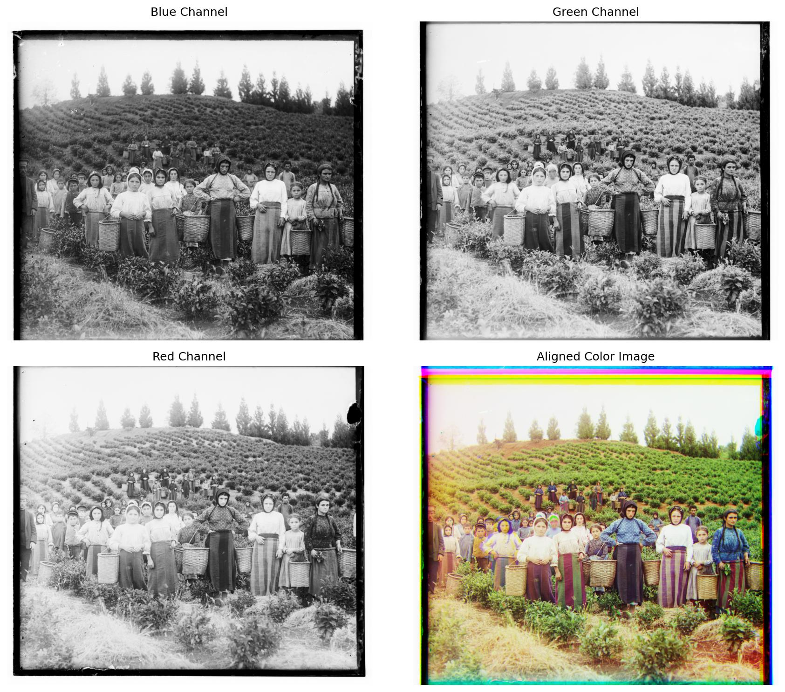
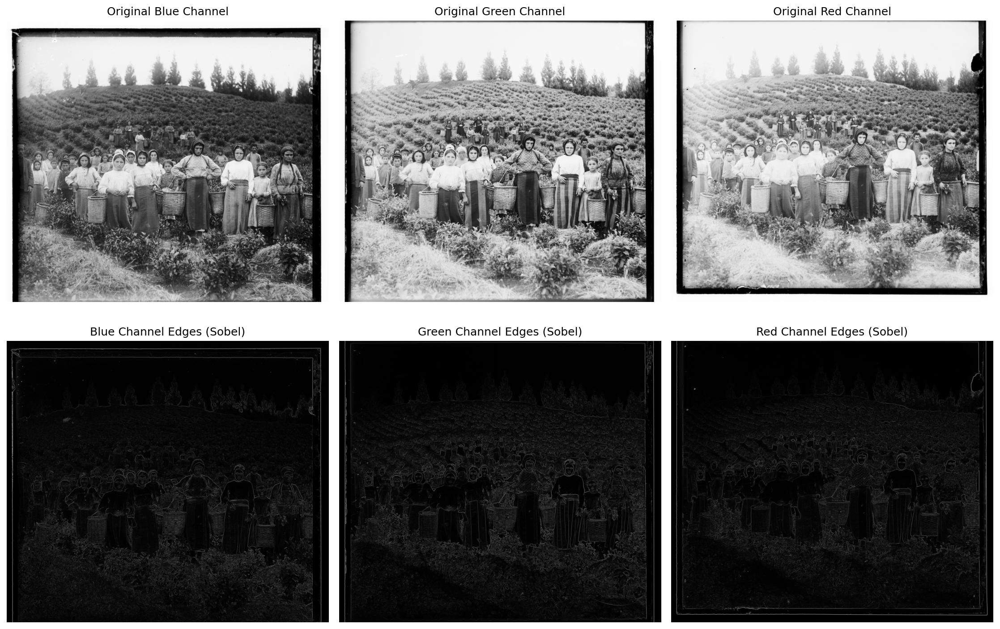
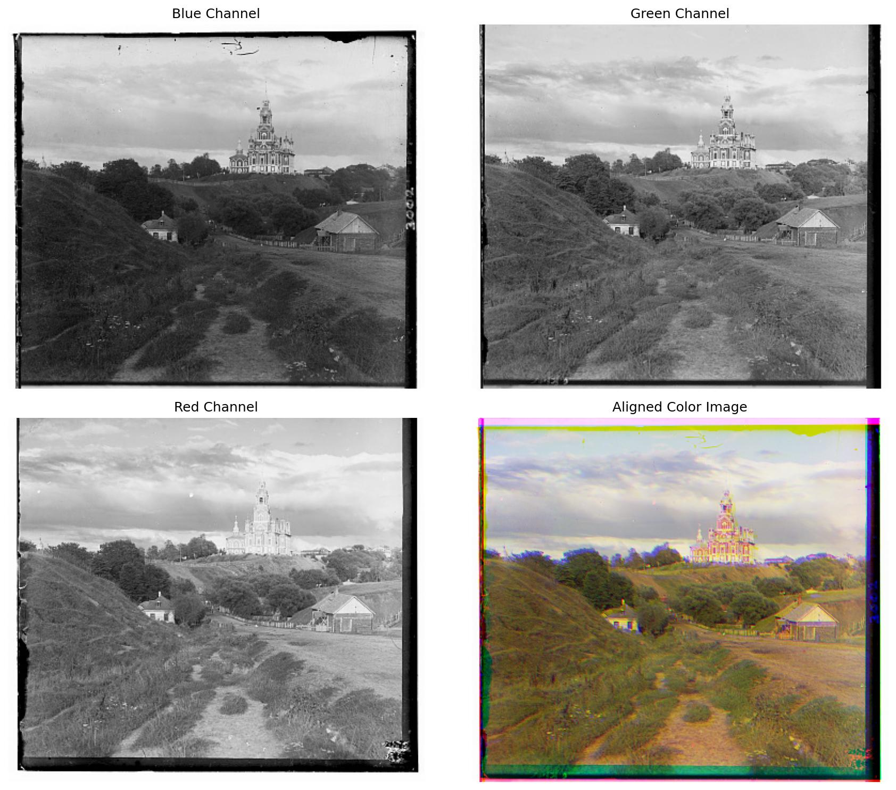
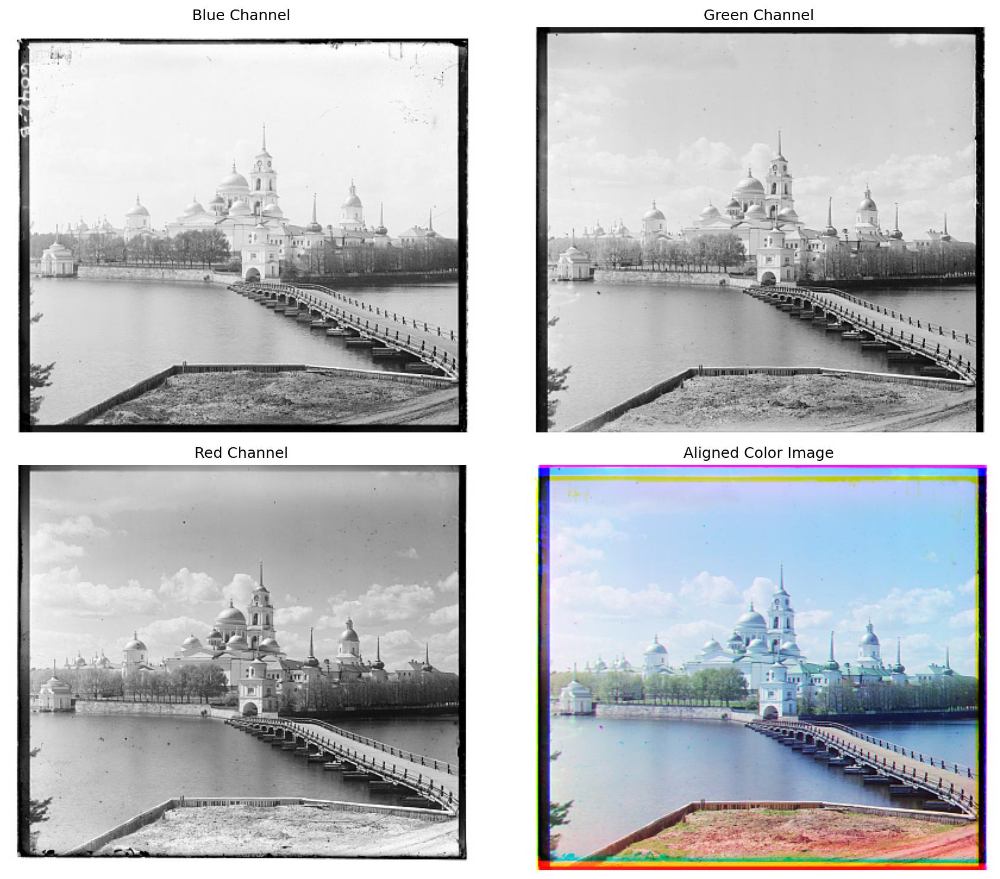
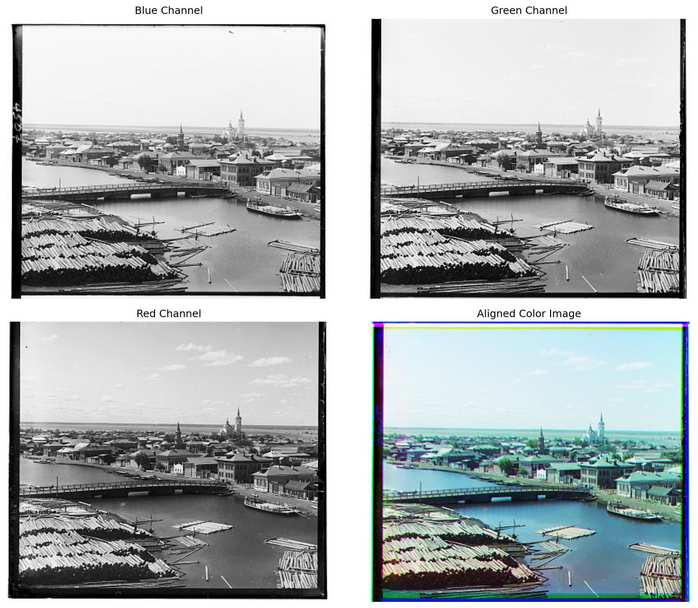

# CS180 Project 1: Colorizing the Prokudin-Gorskii Collection

## Project goal

The Prokudin-Gorskii collection records each scene as three vertically stacked grayscale exposures captured through blue, green, and red filters. The goal of this project is to recover a single color photograph by separating those exposures, registering the green and red channels to the blue reference, and stacking the aligned channels as RGB.

The main challenge is that the channels are displaced by different amounts, especially in high-resolution glass-plate scans. I therefore compare candidate translations with L2 distance, normalized cross-correlation, and SSIM; use cropped image regions to keep borders from dominating the score; and apply coarse-to-fine pyramid alignment for large images. Sobel edge responses provide an additional way to align scene structure when the three exposures have noticeably different brightness.

## Result showcase

### High-resolution plate

The harvesters example shows the three original exposures together with the reconstructed color image. Pyramid alignment makes the large displacement manageable by estimating it first at a coarse scale and refining it at full resolution.

The edge visualization highlights structural features shared across the three channels and reduces the influence of exposure differences.

### Smaller examples

For the smaller JPEG plates, exhaustive single-scale search is sufficient to recover the channel translations.

| Cathedral | Monastery | Tobolsk |
|---|---|---|
|  |  |  |

## Conclusion

This project demonstrates that convincing color can be reconstructed from century-old monochrome exposures with translation-based registration alone. Single-scale search works well for small images, while the image pyramid makes the same search practical for large scans. SSIM and edge-based matching are especially useful when brightness differs between color channels. The remaining color fringes near the plate boundaries come from invalid border regions and imperfect overlap; automatic cropping or border-aware masks would be the most valuable next improvement.
