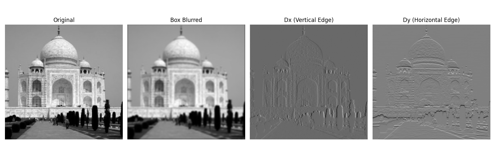
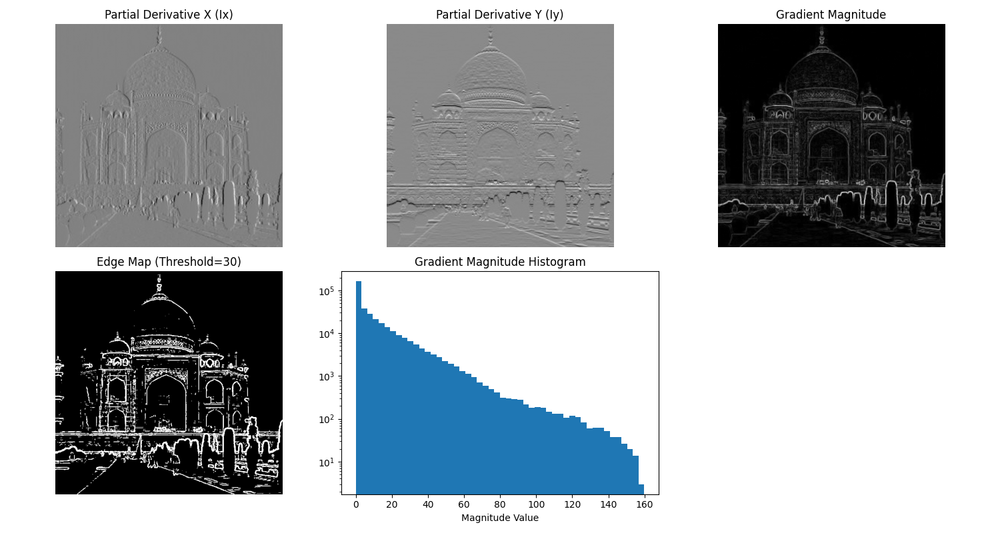
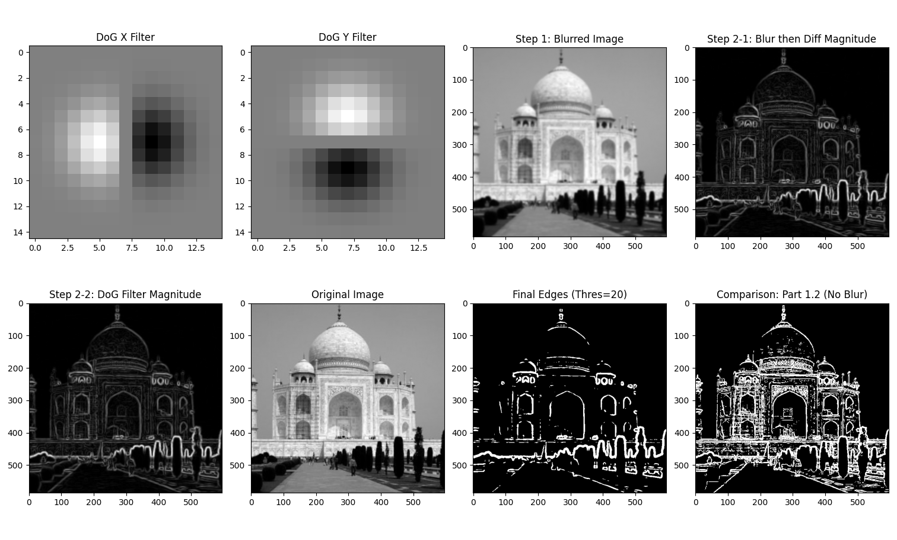
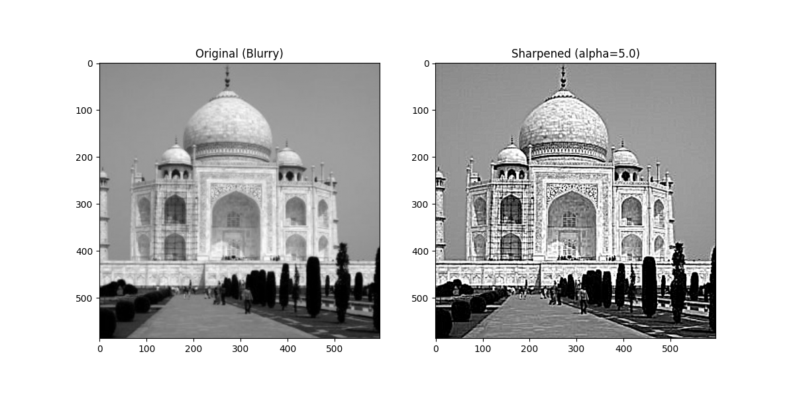
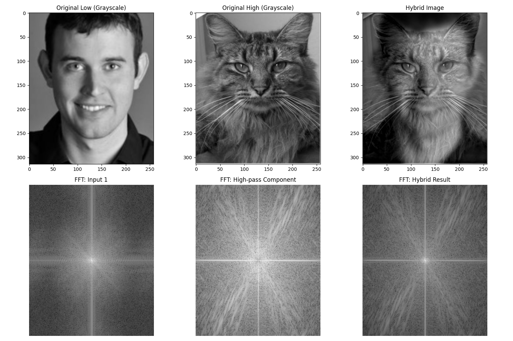
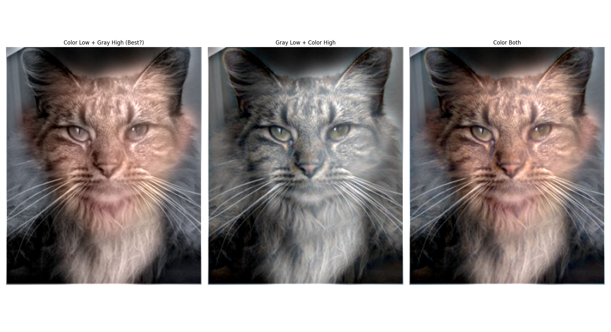
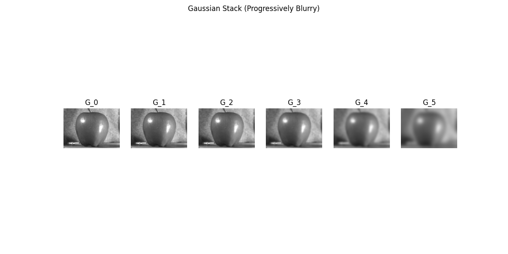
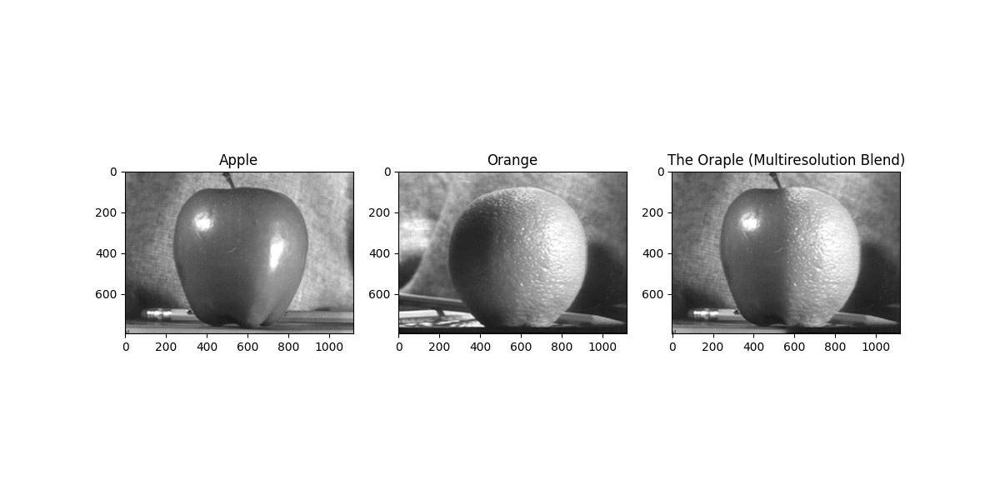
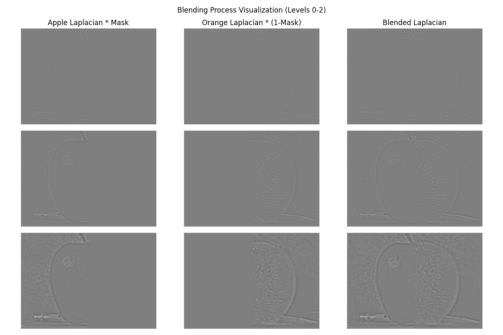

# CS180 Project 2: Fun with Filters and Frequencies

## Project goal

This project investigates how spatial filters and frequency decomposition can be used to analyze and manipulate images. The goal is to build the core operations from first principles, then use them for edge detection, sharpening, hybrid images, multiscale analysis, and seamless blending.

The work begins with a NumPy implementation of 2D convolution and finite-difference gradients. Gaussian smoothing is then combined with derivatives to suppress noise, while high- and low-frequency components are recombined for sharpening and hybrid images. Finally, Gaussian and Laplacian stacks provide a multiresolution representation for blending images without a hard seam.

## Result showcase

### Convolution and edge detection

The custom convolution implementation reproduces standard filtering behavior, while finite differences reveal horizontal and vertical intensity changes. Smoothing before differentiation produces a cleaner edge map with fewer noise responses.

| Convolution from scratch | Finite-difference edges | Derivative of Gaussian |
|---|---|---|
|  |  |  |

### Sharpening

Sharpening isolates the high-frequency residual between an image and its Gaussian-blurred version, then adds a scaled version of that residual back to the image.

### Hybrid images

A hybrid image combines the low frequencies of one aligned image with the high frequencies of another. Its interpretation changes with viewing distance: fine detail dominates up close, while the low-frequency structure becomes more visible from farther away.

| Hybrid image | Frequency-domain analysis |
|---|---|
|  |  |

### Gaussian and Laplacian stacks

The Gaussian stack progressively removes fine detail. The Laplacian stack stores the band-pass information between adjacent Gaussian levels, allowing the image to be reconstructed from its frequency bands.

### Multiresolution blending

Blending the apple and orange independently at each Laplacian level produces a gradual transition across scales and avoids the obvious boundary created by direct compositing.

| Oraple | Additional multiresolution blend |
|---|---|
|  |  |

## Conclusion

The experiments show that many visual effects are different ways of controlling image frequency content. Derivative filters expose rapid changes, Gaussian filters suppress high frequencies, sharpening restores them, and hybrid images deliberately assign different frequency bands to different subjects. The multiresolution blend is the clearest practical result: operating on Laplacian bands produces a much smoother boundary than blending all detail at one scale. Good alignment and carefully selected cutoff scales remain essential, because frequency methods cannot hide geometric mismatch between source images.
