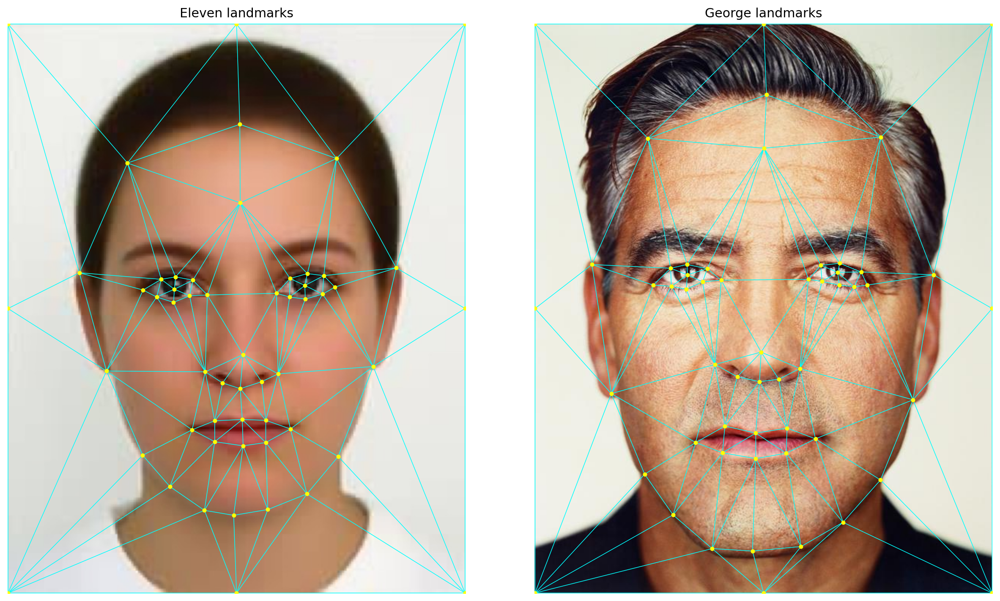
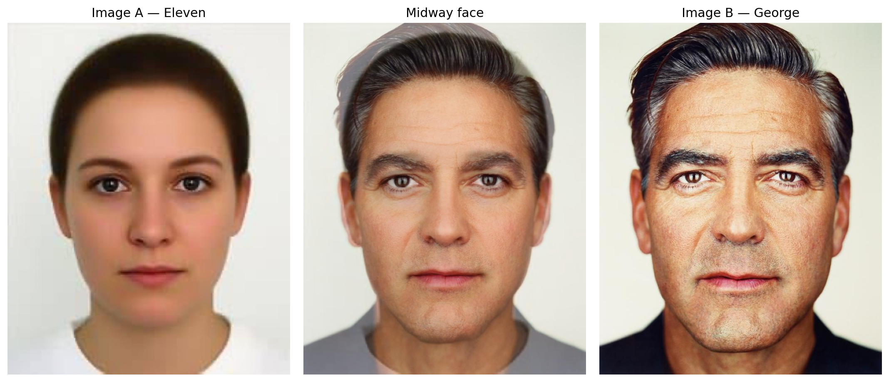
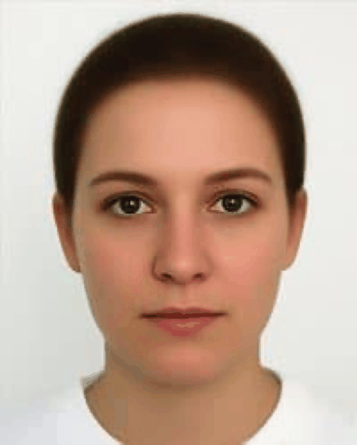
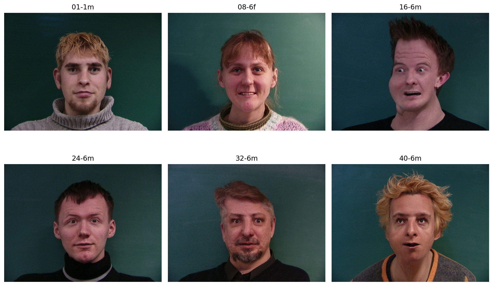
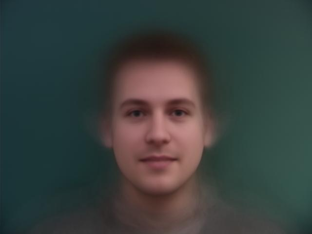
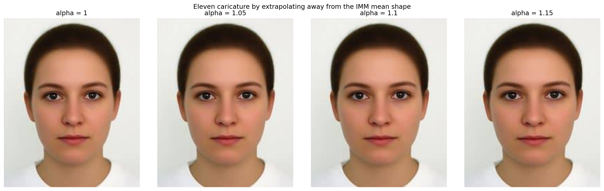

# CS180 Project 3：Face Morphing

## 專案目標

本專案的目標是讓兩張人臉自然地互相轉換，並進一步從一組人臉資料建立 population mean face 與 caricature。核心問題不只是混合兩張圖片的顏色，而是要同時處理臉部幾何形狀與外觀：先在兩張臉上標記相同語意的特徵點，以 Delaunay triangulation 建立共同網格，再對每個三角形進行 inverse affine warp，最後以 cross-dissolve 融合顏色。

專案包含四個主要成果：Eleven 與 George 的 midway face、完整 morph sequence、IMM Face Dataset 的平均臉，以及將 Eleven 相對於平均臉的差異外插後得到的 caricature。

## 成果展示

### 特徵點與三角網格

對應特徵點決定眼睛、鼻子、嘴巴、輪廓等部位在 morph 過程中的移動方向。兩張圖片共用同一份 triangulation，可避免轉換過程中網格拓樸突然改變。

### Midway face

Midway face 使用兩張臉的平均幾何形狀，先將 Eleven 與 George 各自 warp 到中間形狀，再以 50% 比例融合外觀。

### Morph sequence

完整動畫同步改變 shape warp fraction 與 dissolve fraction，共輸出 46 個中間影格，形成從 Eleven 到 George 的連續轉換。

### IMM population mean face

IMM Face Dataset 中 240 張人臉各自附有 58 個 landmark。將每張臉 warp 到平均 landmark geometry 後逐像素平均，可以把個別差異消除並保留資料集共有的臉部結構。

| Warped examples | Population mean face |
|---|---|
|  |  |

### Caricature

Caricature 將 Eleven 與 population mean 的形狀差異向外延伸：

`P_caricature = P_mean + alpha × (P_Eleven - P_mean)`

當 `alpha > 1` 時，Eleven 相對於平均臉的幾何特徵會被放大；比較圖呈現不同外插強度對臉型的影響。

## 結論

這個專案顯示，自然的人臉 morph 必須同時處理幾何與顏色；單純 cross-dissolve 只能得到重影，無法對齊五官。共同的 landmark 順序、穩定的 triangulation 與逐三角形 inverse warp，是讓轉換連續的關鍵。Population mean face 則把同一套方法擴展到整個資料集，而 caricature 進一步證明「個人特徵」可以視為個體形狀相對於平均形狀的向量。成果中最敏感的環節仍是 landmark 品質：少數位置錯誤就可能造成三角形翻轉或局部拉扯，因此更可靠的自動 landmark detection 會是最直接的改進方向。
