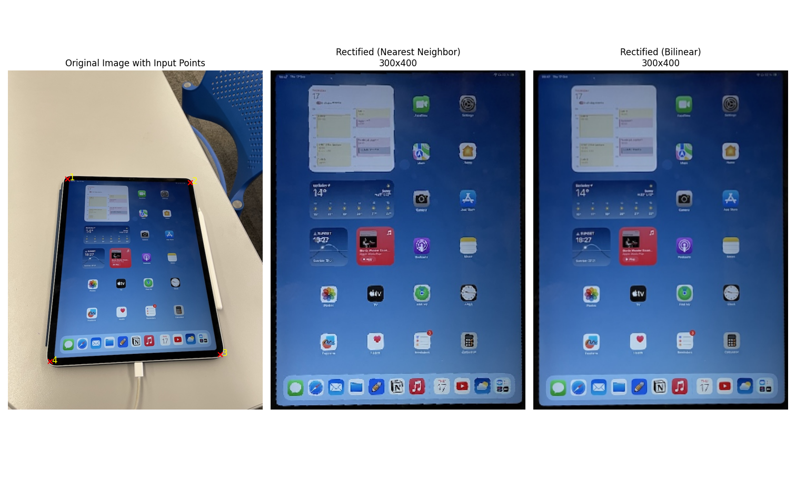
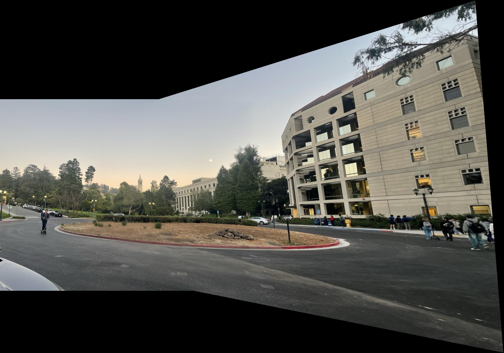
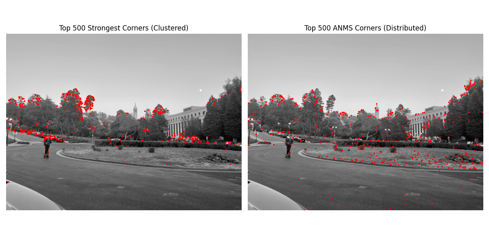
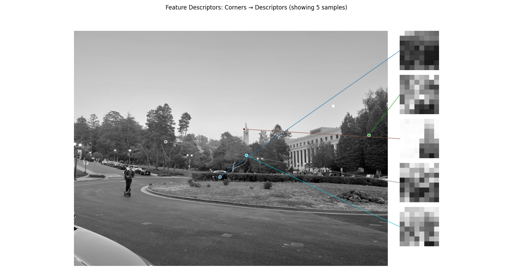
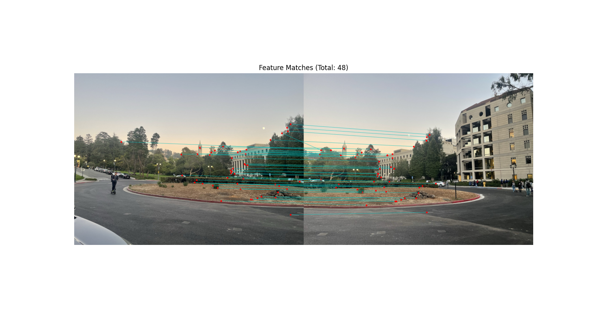
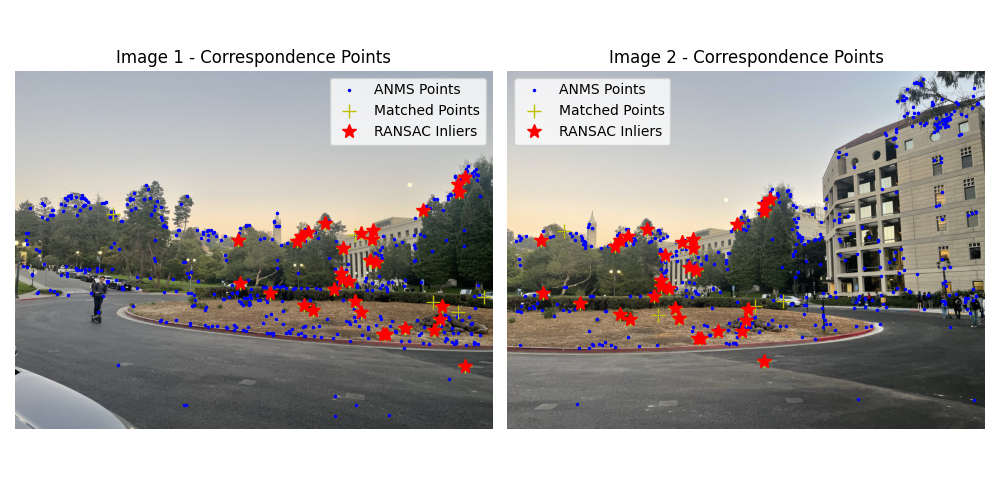
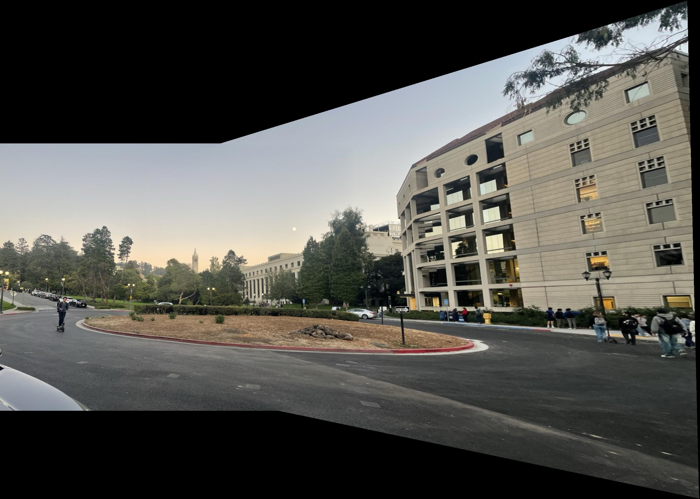

# CS180 Project 4: Image Mosaics and Feature Matching

## Project goal

The goal of this project is to combine overlapping photographs into a wider field-of-view mosaic. The first stage studies the geometry directly: manually selected correspondences are used to estimate a projective homography, warp one photograph into another photograph's coordinate system, and blend the overlap. The second stage replaces manual correspondences with a complete automatic feature-matching pipeline.

Automatic stitching detects Harris corners, distributes them spatially with Adaptive Non-Maximal Suppression (ANMS), describes normalized local patches, matches descriptors with a nearest-neighbor ratio test, and uses RANSAC to reject outliers before estimating the final homography. Inverse warping with bilinear interpolation fills the mosaic canvas, while distance-based weights soften the seam in overlapping regions.

## Result showcase

### Manual correspondences and homography

Point correspondences provide the constraints needed to solve for the eight free parameters of a 3 × 3 homography. The recovered transform maps the photographs onto a common projective plane.

### Manual mosaic

After warping, both photographs are placed on a shared canvas and blended across their overlap. The scene remains geometrically aligned across the central region despite the viewpoint change.

### Automatic feature pipeline

Harris detection produces many candidate corners; ANMS keeps a smaller set that is both strong and well distributed. Patch descriptors then provide a compact representation for comparing those points across images.

| Harris corners and ANMS | Feature descriptors | Candidate matches |
|---|---|---|
|  |  |  |

### RANSAC and automatic mosaic

RANSAC repeatedly fits a homography from minimal four-point samples and retains the model supported by the largest inlier set. This removes mismatched features before the final warp and blend.

| RANSAC inliers | Automatically stitched mosaic |
|---|---|
|  |  |

## Conclusion

The project shows that panorama stitching depends on both projective geometry and robust correspondence selection. Manual points verify that homography-based warping can align a mostly planar scene, while the automatic pipeline reaches the same goal without hand-selected landmarks. ANMS improves spatial coverage, the ratio test removes ambiguous descriptor matches, and RANSAC is essential for preventing the remaining outliers from corrupting the transform. The final mosaics align the shared scene successfully; their black canvas regions and small exposure differences also reveal the next improvements to make—automatic cropping, exposure compensation, and seam-aware blending.
