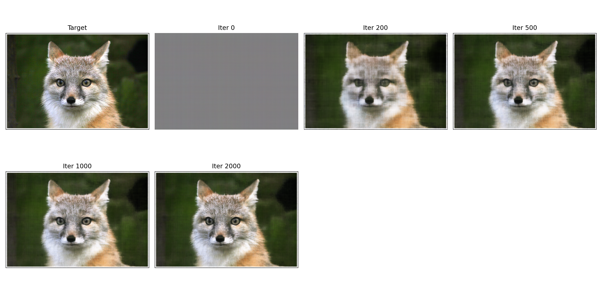
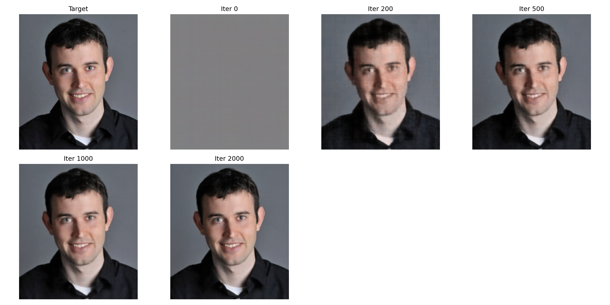
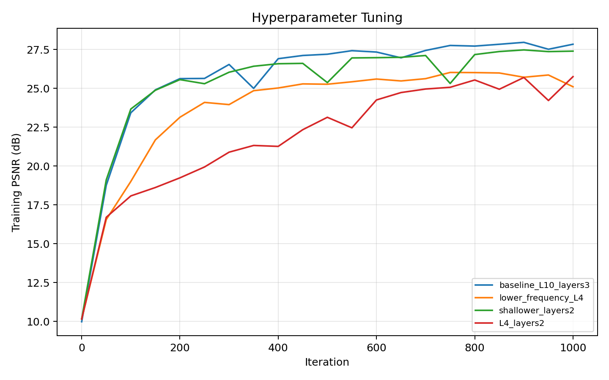
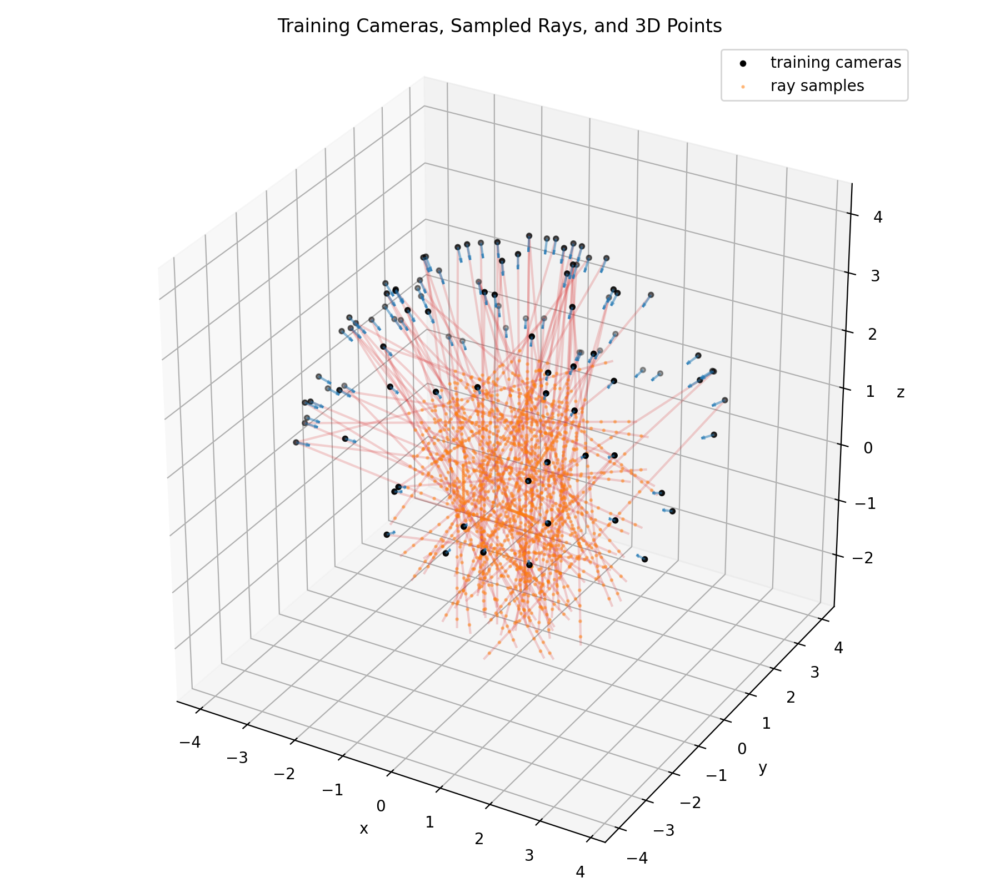
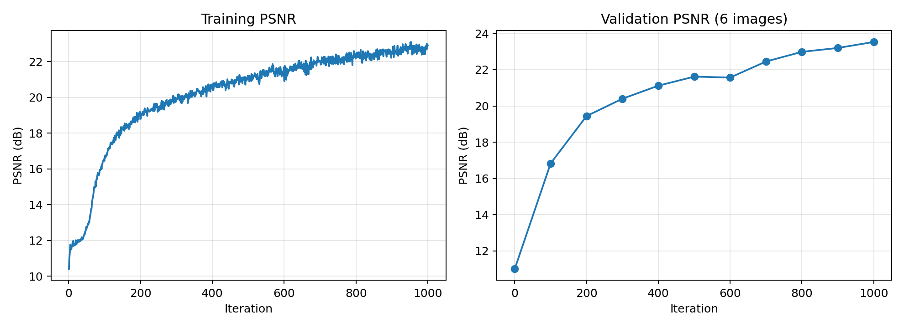
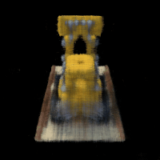

# CS180 Project 5: Neural Fields and NeRF

## Project goal

This project explores how a neural network can represent visual data as a continuous function instead of a fixed pixel grid. Part 1 fits a 2D neural field that maps positional-encoded pixel coordinates to RGB values. Part 2 extends the idea to a 3D scene with a Neural Radiance Field (NeRF), where the network predicts density and view-dependent color at sampled locations along camera rays.

The full pipeline includes sinusoidal positional encoding, random pixel and ray sampling, camera-to-world transformations, stratified samples between near and far bounds, a view-conditioned multilayer perceptron, and differentiable volume rendering. PSNR is tracked throughout training to measure how closely the rendered output matches the target images.

## Result showcase

### Part 1: Fitting 2D images

The baseline neural field uses three 256-unit hidden layers and ten positional-encoding frequencies. As optimization progresses, broad colors appear first and high-frequency details are recovered later.

| Official cat image | Personal image |
|---|---|
|  |  |
| **Final PSNR: 28.97 dB** | **Final PSNR: 40.25 dB** |

The hyperparameter experiment varies encoding bandwidth and network depth while keeping the optimizer, sample count, and random seed fixed. The comparison shows how model capacity and positional encoding affect the network's ability to reproduce fine detail.

### Part 2: Constructing rays and samples

Each pixel center is transformed through the inverse camera intrinsics and the camera-to-world matrix to form a world-space ray. During training, 64 stratified samples are drawn between `near = 2.0` and `far = 6.0` along each ray.

### NeRF reconstruction

The NeRF uses an eight-layer, 256-unit position network with a skip connection and a separate view-direction branch. Volume rendering accumulates color according to the density and transmittance predicted along each ray.

Validation PSNR across six held-out views reaches **23.53 dB** after 1,000 iterations. The learned radiance field can then render a continuous spherical camera path that was not present in the training set.

## Conclusion

The experiments demonstrate that positional encoding allows an MLP to recover image detail that a plain coordinate network would struggle to represent. In 2D, the network reconstructs both test images with high PSNR, although the difference between 28.97 dB and 40.25 dB also shows that image complexity strongly affects fitting difficulty. In 3D, the model learns enough geometry and appearance from multiview supervision to synthesize a smooth novel-view trajectory, reaching 23.53 dB on held-out views. The remaining softness and reconstruction error are consistent with the limited 1,000-iteration training budget; longer training, hierarchical sampling, and a coarse-to-fine NeRF would be natural next steps.
